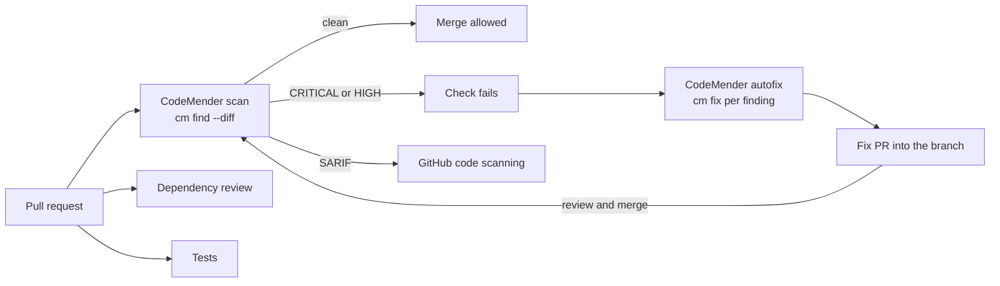

# hardened-ci-demo

A small Flask service whose pull requests are gated by [Google CodeMender](https://docs.cloud.google.com/gemini-enterprise-agent-platform/agents/codemender). The point of the repository is the pipeline, not the app.

## What runs on a pull request



| Check | Tool | What it catches | Blocks merge |
|---|---|---|---|
| `CodeMender scan` | Google CodeMender via [eggboy/codemender-action](https://github.com/eggboy/codemender-action) | Vulnerabilities in the code the pull request changes, plus the files that depend on it. Findings in untouched code are reported as `[LEGACY / UNTOUCHED]` and don't block | Yes |
| `CodeMender autofix` | same | Runs `cm fix` for each blocking finding and opens `codemender/fix-pr-N` into the pull request branch. A person reviews and merges it | n/a |
| `Dependency review` | GitHub | Added or upgraded dependencies with a known high-severity advisory | Yes |
| `Tests` | pytest, ruff | Regressions and style | Yes |

Secrets are covered by GitHub's push protection, which is on for public repositories.

## How CodeMender is wired in

The whole integration is one job in [`.github/workflows/pr.yml`](.github/workflows/pr.yml):

```yaml
codemender:
  uses: eggboy/codemender-action/.github/workflows/codemender.yml@<sha>
  permissions: { contents: write, pull-requests: write, id-token: write, security-events: write, actions: read }
  secrets: { GCP_PROJECT_ID: ..., GCP_WIF_PROVIDER: ..., GCP_WIF_SERVICE_ACCOUNT: ... }
```

GitHub Actions authenticates to Google Cloud with Workload Identity Federation (short-lived OIDC tokens, no service account keys). The service account holds `roles/aiplatform.user` and nothing else. The one-time Google Cloud setup is a single script in the action repository.

## Run it locally

```bash
uv venv && uv pip install -e '.[dev]'
make lint test
python -m demoapp.main
```

## Limits worth knowing

- CodeMender is a pre-GA product; its terms restrict use to testing and evaluation.
- Fork and Dependabot pull requests skip the CodeMender scan (no access to secrets), and GitHub reports a skipped job as passing.
- The fixes are AI-generated. Review each commit before merging a fix pull request.
