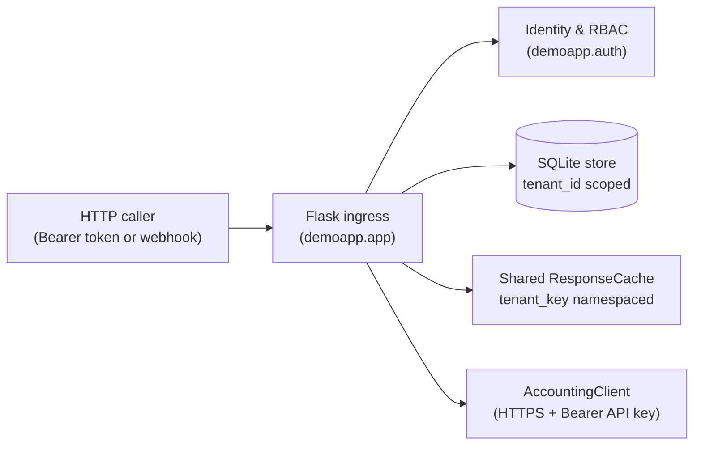
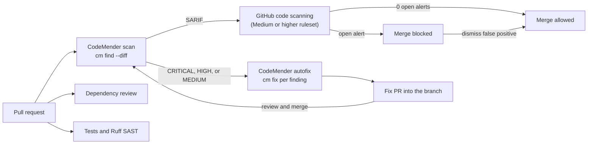

# hardened-ci-demo

A multi-tenant B2B workspace and invoice service whose pull requests are gated by [Google CodeMender](https://docs.cloud.google.com/gemini-enterprise-agent-platform/agents/codemender) and GitHub code scanning merge protection. The repository demonstrates how an AI-native security agent catches architectural, authorization, and adversarial flaws that pass traditional rule-based SAST (`ruff` with Bandit `S` rules), unit tests (`pytest`), and dependency scanning.

## Architecture and trust boundaries

The service manages workspace tenants (`tenants`), role-bound users (`admin` and `member`), SHA-256 hashed bearer credentials (`api_tokens`), and confidential customer invoices (`invoices`).



- **HTTP ingress (`demoapp.app`)**: Untrusted request bodies, query parameters, and headers enter here.
- **Principal and RBAC (`demoapp.auth`)**: Maps `Authorization: Bearer <token>` to an immutable `Principal(user_id, tenant_id, role)` and enforces `admin` vs `member` permissions.
- **Persistence (`demoapp.db`)**: Parameterized SQLite queries scoped by `tenant_id`.
- **Shared cache (`demoapp.cache`)**: Process-local cache keyed via `tenant_key(tenant_id, resource, resource_id)` so cached records never cross tenant boundaries.
- **Outbound integration (`demoapp.notifier`)**: Sends invoice exports over HTTPS using the server's `ACCOUNTING_API_KEY`.

## What runs on a pull request

Pull requests pass through a two-layer CodeMender gate alongside dependency review, unit tests, and Bandit SAST. `CodeMender scan` enforces scan execution health and triggers `CodeMender autofix` for `CRITICAL`, `HIGH`, and `MEDIUM` findings, while a GitHub repository ruleset (`Require code scanning results` at `Medium or higher`) blocks merges on open alerts and honors documented false-positive dismissals.



| Check | Tool | What it catches | Blocks merge |
|---|---|---|---|
| `CodeMender` (code scanning) | GitHub code scanning ruleset (`Medium or higher`) | Open `CRITICAL`, `HIGH`, or `MEDIUM` alerts in pull request diffs across **Trust Boundary Analysis** (cross-tenant cache bleed, SSRF with credential exfiltration), **Identity & Authorization Context** (horizontal tenant escalation, BOLA, missing RBAC checks), and **Adversarial Reasoning** (conditional signature bypasses in webhooks). Unblocks when a maintainer dismisses a documented false positive | Yes |
| `CodeMender scan` | Google CodeMender via [eggboy/codemender-action](https://github.com/eggboy/codemender-action) | Setup, authentication, or scan execution failures; uploads SARIF and exports `CRITICAL`, `HIGH`, and `MEDIUM` findings to autofix | Yes (scan health) |
| `CodeMender autofix` | same | Runs `cm fix` for each exported finding and opens `codemender/fix-pr-N` into the pull request branch for human review | n/a |
| `Dependency review` | GitHub | Added or upgraded dependencies with a known high-severity advisory | Yes |
| `Tests` | `pytest`, `ruff` (`E`, `F`, `I`, `UP`, `B`, `S`) | Regressions, style, and pattern-based Bandit (`S`) checks (SQL string interpolation, hardcoded secrets, missing HTTP timeouts) | Yes |

Secrets are also covered by GitHub push protection on public repositories, and `.github/dependabot.yml` tracks hash-pinned GitHub Actions releases weekly.

## How CodeMender is wired in

The integration is a single job in [`.github/workflows/pr.yml`](.github/workflows/pr.yml) paired with a repository branch ruleset requiring both the `CodeMender scan` status check and `CodeMender` code scanning results (`Medium or higher`):

```yaml
codemender:
  uses: eggboy/codemender-action/.github/workflows/codemender.yml@<commit-sha> # v0.21.0
  with:
    fail-on: CRITICAL,HIGH,MEDIUM
    fail-check: false
  permissions: { contents: write, pull-requests: write, id-token: write, security-events: write, actions: read }
  secrets: { GCP_PROJECT_ID: ..., GCP_WIF_PROVIDER: ..., GCP_WIF_SERVICE_ACCOUNT: ... }
```

Setting `fail-check: false` delegates finding-level merge blocking to GitHub code scanning while keeping `CodeMender scan` red if `cm health` or `cm find` crashes. GitHub Actions authenticates to Google Cloud with Workload Identity Federation using short-lived OIDC tokens and no service account keys. The service account holds `roles/aiplatform.user` and nothing else.

## Run locally

```bash
uv venv && uv pip install -e '.[dev]'
make lint test
python -m demoapp.main
```

## Limits worth knowing

- CodeMender is a pre-GA product; its terms restrict use to testing and evaluation.
- Fork and Dependabot pull requests skip the CodeMender scan because they have no access to repository secrets, and GitHub reports a skipped job as passing.
- Autofix commits are AI-generated. Review each commit and run tests before merging a fix pull request.
- Without a required second reviewer (such as code-owner review in an organization), a maintainer with write access can edit `.github/workflows/pr.yml` inside their own pull request.
- GitHub code scanning merge protection only blocks an alert when all lines reported for that alert sit inside the pull request diff.
